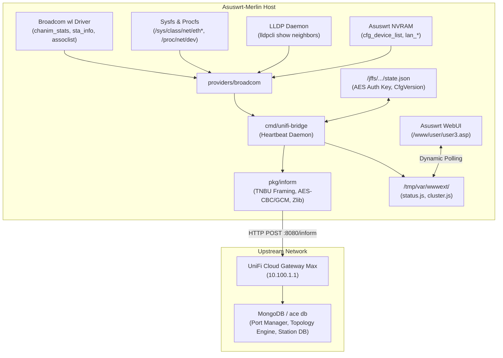

# Architecture & Technical Reference

`unifi-ap-bridge` is a standalone, dependency-free daemon and WebUI extension engineered for Asuswrt-Merlin and Broadcom-based routers. It translates raw Linux and Broadcom wireless and switch telemetry into the Ubiquiti UniFi Inform protocol (`:8080/inform`).

---

## 1. High-Level System Architecture



---

## 2. Telemetry Ingestion Subsystems

### 2.1 Broadcom Wireless Telemetry (`providers/broadcom/asus.go`)
* **Radio & Band Enumeration:**
  * Discovers active interfaces from NVRAM (`wl_ifnames`, `lan_ifnames`).
  * Maps physical Broadcom radios (`eth4`, `eth5`, `eth6`) into normalized UniFi bands: `wifi-ng` (2.4 GHz) and `wifi-na` (5 GHz High/Low).
  * Evaluates channel spectrum configuration using Broadcom chanspec encoding (`wl chanspec`).
* **RF Airtime & Channel Utilization:**
  * Queries `wl chanim_stats` periodically.
  * Computes total channel load (`cu_total`), AP transmit airtime (`cu_self_tx`), and AP receive airtime (`cu_self_rx`), populating `radio_table` and `radio_table_stats`.
* **Station Metrics & WiFi Experience:**
  * Queries `wl assoclist` to retrieve connected station MACs.
  * For each associated station, queries `wl sta_info <MAC>` to extract:
    * Signal/Noise/RSSI attenuation.
    * Bitrates (`tx_rate`, `rx_rate`).
    * Unicast traffic counters (`tx_bytes`, `rx_bytes`, `tx_packets`, `rx_packets`).
    * Transmission retries and association duration.
  * Computes dynamic `satisfaction` (0–100%) score based on SNR thresholds and retry rate penalties.

### 2.2 Physical Switch Port Telemetry
* **Hardware Port Mapping (Broadcom BCM4908 / BCM53134):**
  * `eth0`: 2.5 Gbps Port 1 (WAN / Uplink)
  * `eth1`: 1.0 Gbps Port 2 (LAN 1)
  * `eth2`: 1.0 Gbps Port 3 (LAN 2)
  * `eth3`: 1.0 Gbps Port 4 (LAN 3)
* **Real-time Interface State:**
  * Carrier state queried via `/sys/class/net/<ifname>/carrier`.
  * Negotiated speed queried via `/sys/class/net/<ifname>/speed` (2500, 1000, 100, 10).
  * Duplex queried via `/sys/class/net/<ifname>/duplex`.
  * Wire counters parsed from `/proc/net/dev`.
* **UniFi Port Manager Emulation (`U6-IW`):**
  * Emulates UniFi 6 In-Wall, enabling multi-port switch capabilities in the UniFi controller.
  * Emits `port_table` and `sw_port_table` with `op_mode: "switch"`, `forward: "all"`, `autoneg: true`, `enabled: true`, and spanning tree states (`stp_state: "forwarding"` when active, `"disabled"` when link down).

### 2.3 LLDP Neighbor Discovery & Topology Resolution
* **The Topology Challenge:**
  * Linux bridges on UniFi Gateways (such as `br0` on Cloud Gateway Max) use locally administered MAC addresses (`6e:...`), while the controller database keys devices strictly by their burned-in hardware MAC (`6c:63:f8:30:9a:05`).
  * Querying ARP returns the bridge MAC, causing topology resolution to fail ("Connected To" shows `-`).
* **The LLDP Solution:**
  * The daemon queries the native LLDP subsystem via `lldpcli -f json show neighbors`.
  * Extracts:
    * `chassis.id.value` &rarr; Upstream gateway device MAC (`6c:63:f8:30:9a:05`).
    * `port.id.value` &rarr; Upstream physical port MAC (`6c:63:f8:30:9a:05` for Port 1, `6c:63:f8:30:9a:07` for Port 3).
    * `port.descr` &rarr; Remote port mapping (`eth0` &rarr; Port 1, `eth2` &rarr; Port 3).
  * Injects `uplink_mac`, `last_uplink`, and `lldp_table` entries into the inform payload, enabling the UniFi controller to automatically compute topology downlinks.

---

## 3. UniFi Inform Protocol Engine (`pkg/inform`)

### 3.1 Packet Framing (`TNBU`)
All communication with `:8080/inform` utilizes the UniFi binary wire packet format:
```text
+-------------------+-------------------+-------------------+-------------------+
| Magic: "TNBU"     | Packet Version    | MAC Address (6B)  | Flags (2B)        |
| (4 Bytes)         | (4 Bytes)         | (6 Bytes)         | (2 Bytes)         |
+-------------------+-------------------+-------------------+-------------------+
| IV (16 Bytes)     | Payload Version   | Payload Length    | Encrypted Payload |
| (AES Initialization) | (4 Bytes)      | (4 Bytes)         | (Zlib Compressed) |
+-------------------+-------------------+-------------------+-------------------+
```

### 3.2 Cryptographic Lifecycle
1. **Pending Adoption (Bootstrap):**
   * Pre-adoption packets are encrypted using **AES-128-CBC** with the fixed bootstrap key `ba86f2bbe107c7c57eb5f2690775c1e2` (MD5 of `"ubnt"`).
   * Device reports `default: true` and `state: 1`.
2. **Adoption Key Exchange (`setparam`):**
   * The operator clicks "Adopt" in the UniFi UI.
   * Controller responds with an encrypted `setparam` directive containing a unique 16-byte random `authkey`.
   * Bridge stores the key with `0600` permissions in `/jffs/addons/unifi-bridge/state.json`.
3. **Adopted Mode (Steady State):**
   * Bridge acknowledges adoption, transitioning to **AES-128-GCM** encryption (authenticated with 16-byte GCM tag).
   * Device reports `default: false` and `state: 4`.
   * Telemetry streams continuously at 10-second intervals.

---

## 4. WebUI Architecture & Lifecycle

### 4.1 Dynamic User Slot Allocation
Asuswrt-Merlin exposes customizable navigation slots via `/www/user/user1.asp` through `user20.asp`. To avoid collisions with existing addons:
* At install time, the bridge scans `/www/user/` for the first available slot.
* Registers the slot title in `/www/user/<slot>.title` ("UniFi Bridge").
* Injects navigation links into `Advanced_Wireless_Content.asp` top tabs.

### 4.2 Zero-Reload Form Architecture
Standard Asuswrt forms submit to `/start_apply.htm` in a hidden iframe, which triggers `top_delay_redirect()` or `parent.refreshpage()`, causing the browser to reload the entire page and lose form state.
* **Neutralization:** On load and before submission, `window.refreshpage = function() {}` neutralizes reload handlers.
* **Target Isolation:** `document.form.current_page.value = ""` and `document.form.next_page.value = ""` instruct `start_apply.htm` to terminate silently in the iframe.
* **Dynamic Background Polling:** The WebUI injects cache-busted `<script>` tags referencing `/tmp/var/wwwext/unifi-bridge/status.js` and `cluster.js` every 15 seconds (optional) or upon manual action.
* **Targeted DOM Patching:** Only text counters and table rows are rewritten; form inputs (`<input>`, `<select>`) are populated strictly once via `initFormOnce()` and never clobbered.

---

## 5. Cluster Synchronization (`scripts/sync_nodes.sh`)

In AiMesh or multi-AP environments, one router operates as the Main AP and satellites operate as Node APs.
* **Discovery:** Main AP inspects native NVRAM `cfg_device_list`, `asus_device_list`, and MerVLAN configurations to discover satellite IPs.
* **Identity Isolation:** During synchronization, `/jffs/addons/unifi-bridge/state.json` is explicitly excluded from distribution. Each AP maintains its own independent adoption key, preventing identity collisions in the controller.
* **Remote Dispatch:** Pushes configuration updates, scripts, and binaries over SSH using dropbear host keys.
* **Cluster Reporting:** Aggregates remote node statuses into `/tmp/var/wwwext/unifi-bridge/cluster.js` to render the multi-node status matrix in the WebUI.
