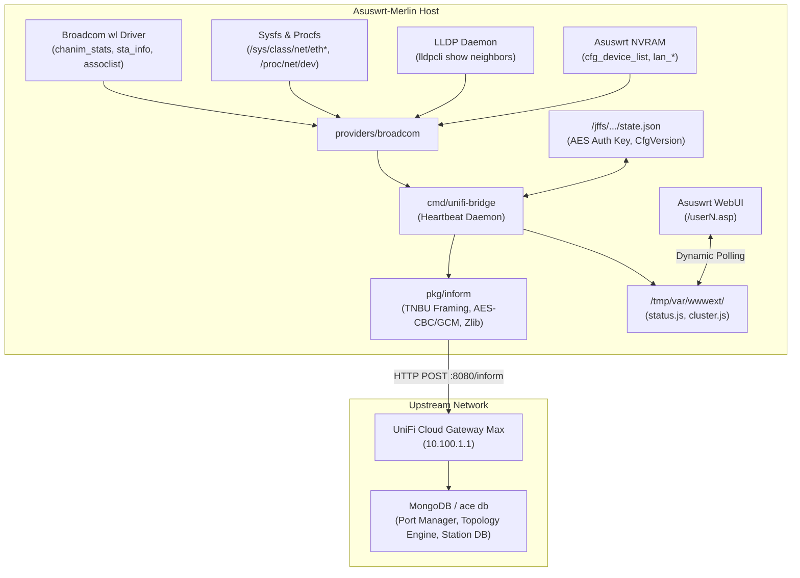

# Architecture & Technical Reference

> **Current delivery status — 2026-10-26 PDT:** Main is runtime-accepted on `1fc317c`, with fresh GCM and live passive RF metrics; Node remains untouched on last-verified `6224430`. Reboot dispatch is disabled and no scan was run. Asus browser/settings acceptance and controller display issues remain pending. See [the canonical live ledger](AUDIT_STATE.md#21-main-wireless-batch-deployment--2026-10-27-0403-utc).

`unifi-ap-bridge` is a standalone, dependency-free daemon and WebUI extension engineered for Asuswrt-Merlin and Broadcom-based routers. It translates raw Linux and Broadcom wireless and switch telemetry into the Ubiquiti UniFi Inform protocol (`:8080/inform`).

This reference describes v1.2.5 source unless explicitly dated as deployed. See [current audit and release status](AUDIT_STATE.md) for evidence and remaining acceptance work.

---

## 1. High-Level System Architecture



---

## 2. Telemetry Ingestion Subsystems

### 2.1 Broadcom Wireless Telemetry (`providers/broadcom/asus.go`)
* **Radio & Band Enumeration:**
  * Discovers active interfaces from NVRAM (`wl_ifnames`) and configured virtual interfaces (`wlN_vifnames`), skipping explicitly disabled BSS interfaces.
  * Maps physical Broadcom radios (`eth4`, `eth5`, `eth6`) into normalized UniFi bands: `wifi-ng` (2.4 GHz) and `wifi-na` and `wifi-na-1` (distinct 5 GHz radios). VAPs and counts retain their physical parent; three-radio overview acceptance under U6IW passed on both APs on 2026-10-25.
  * Evaluates channel spectrum configuration using Broadcom chanspec encoding (`wl chanspec`).
* **RF Airtime & Channel Utilization:**
  * Queries `wl chanim_stats` periodically.
  * Computes total channel load (`cu_total`), AP transmit airtime (`cu_self_tx`), and AP receive airtime (`cu_self_rx`), populating `radio_table` and `radio_table_stats`.
* **Station Metrics & WiFi Experience:**
  * Queries `wl assoclist` to retrieve connected station MACs.
  * For each associated station, queries `wl sta_info <MAC>` to extract:
    * Signal/Noise/RSSI attenuation.
    * Bitrates (`tx_rate`, `rx_rate`).
    * Unicast traffic counters (`tx_bytes`, `rx_bytes`, `tx_packets`, `rx_packets`).
    * Transmission retries and association duration.
  * Computes dynamic `satisfaction` (0–100%) score using a signal/cumulative-retry heuristic. Missing signal omits the score; unknown noise is not fabricated. Interval-based retry scoring remains pending.

### 2.2 Physical Switch Port Telemetry
* **Hardware Port Mapping (Broadcom BCM4908 / BCM53134):**
  * `eth0`: 2.5 Gbps Port 1 (WAN / Uplink)
  * `eth1`: 1.0 Gbps Port 2 (LAN 1)
  * `eth2`: 1.0 Gbps Port 3 (LAN 2)
  * `eth3`: 1.0 Gbps Port 4 (LAN 3)
* **Real-time Interface State:**
  * Carrier state queried via `/sys/class/net/<ifname>/carrier`.
  * Negotiated speed queried via `/sys/class/net/<ifname>/speed` (2500, 1000, 100, 10).
  * Duplex queried via `/sys/class/net/<ifname>/duplex`.
  * Wire counters parsed from `/proc/net/dev`.
* **UniFi Port Manager Emulation (`U6-IW`) & Switch Forwarding Table (`mac_table`):**
  * Emulates UniFi 6 In-Wall, enabling multi-port switch capabilities in the UniFi controller.
  * Emits raw `port_table` telemetry with `op_mode: "switch"`, `forward: "all"`, `autoneg: true`, `enabled: true`, and actual spanning-tree state/cost read from bridge sysfs when available; unknown values are omitted.
  * **Bridge FDB Inspection:** Inspects Linux bridge ports (`/sys/class/net/br0/brif/<iface>/port_no`) and queries `brctl showmacs br0` mapped against `/proc/net/arp`. External wired clients learned on LAN interfaces (`eth1` &rarr; Port 2, `eth2` &rarr; Port 3, `eth3` &rarr; Port 4) populate that port's `mac_table`; `last_connection` is set only for an unambiguous single client. FDB age is last-seen age, not connection uptime; unknown VLAN is omitted.
  * Allows UniFi Port Manager to associate downstream wired devices (such as smart home hubs or Ethernet clients) directly to their physical AP switch ports rather than dumping them onto the upstream gateway.

### 2.3 LLDP Neighbor Discovery & Topology Resolution
* **The Topology Challenge:**
  * Linux bridges on UniFi Gateways (such as `br0` on Cloud Gateway Max) use locally administered MAC addresses (`6e:...`), while the controller database keys devices strictly by their burned-in hardware MAC (`6c:63:f8:30:9a:05`).
  * Querying ARP returns the bridge MAC, causing topology resolution to fail ("Connected To" shows `-`).
* **The LLDP Solution & Conflict Prevention:**
  * The daemon queries the native LLDP subsystem via `lldpcli -f json show neighbors`.
  * Extracts:
    * `chassis.id.value` &rarr; Upstream gateway device MAC (`6c:63:f8:30:9a:05`).
    * `port.id.value` &rarr; Upstream physical port MAC (`6c:63:f8:30:9a:05` for Port 1, `6c:63:f8:30:9a:07` for Port 3).
    * `port.descr` &rarr; Remote port mapping (`eth0` &rarr; Port 1, `eth2` &rarr; Port 3).
  * Preserves dynamically discovered remote ports so cluster configuration synchronization does not overwrite satellite nodes with Main's uplink port, preventing port collisions on the upstream gateway switch.
  * Raw AP informs must send `uplink` as the interface name string (`"eth0"`) and provide live `if_table` rows. UniFi derives the normalized REST uplink object from these and LLDP. Sending the REST-shaped uplink object in an inform fails to populate the parent/speed fields.
  * XT8 interfaces share one hardware MAC. The wire interface builder groups that MAC under the management interface with `num_port: 4`, keeping per-port counters and clients in `port_table`.
  * U6IW informs advertise `fw_caps: 16` (switch-port capability). Network 10.6.109 only merges AP `port_stats` into the UI's `port_table` when that bit is set. Without it, live stats and learned clients can exist while ports still render grey. `sw_port_table` or REST-shaped `ethernet_table` alone does not fix this.
  * Final published-build browser verification established Main on gateway Port 1, Node on Port 3, both 2.5 GbE uplinks active, and HomeBase on Node Port 4 at GbE.

---

## 3. UniFi Inform Protocol Engine (`pkg/inform`)

### 3.1 Packet Framing (`TNBU`)
All communication with `:8080/inform` utilizes the UniFi binary wire packet format:
```text
+-------------------+-------------------+-------------------+-------------------+
| Magic: "TNBU"     | Packet Version    | MAC Address (6B)  | Flags (2B)        |
| (4 Bytes)         | (4 Bytes)         | (6 Bytes)         | (2 Bytes)         |
+-------------------+-------------------+-------------------+-------------------+
| IV (16 Bytes)     | Payload Version   | Payload Length    | Encrypted Payload |
| (AES Initialization) | (4 Bytes)      | (4 Bytes)         | (Zlib Compressed) |
+-------------------+-------------------+-------------------+-------------------+
```

### 3.2 Cryptographic Lifecycle
1. **Pending Adoption (Bootstrap):**
   * Pre-adoption packets are encrypted using **AES-128-CBC** with the fixed bootstrap key `ba86f2bbe107c7c57eb5f2690775c1e2` (MD5 of `"ubnt"`).
   * Device reports `default: true` and `state: 1`.
2. **Adoption Key Exchange (`setparam`):**
   * The operator clicks "Adopt" in the UniFi UI.
   * Controller responds with an encrypted `setparam` directive containing a unique 16-byte random `authkey`.
   * Bridge stores the key with `0600` permissions in `/jffs/addons/unifi-bridge/state.json`.
3. **Adopted Mode (Steady State):**
   * Bridge acknowledges adoption, transitioning to **AES-128-GCM** encryption (authenticated with 16-byte GCM tag).
   * Device reports `default: false` and `state: 4`.
   * Telemetry is sampled at a default 10-second interval. Non-positive configured intervals normalize to 10 seconds; uptime is refreshed from the per-exchange system sample.
   * Controller and persisted keys must decode to 16 bytes of hexadecimal data. Malformed responses cannot replace an existing valid identity.
   * Three consecutive HTTP 401/404 rejections permit adoption recovery. Success, transport failures, HTTP 400, and other HTTP statuses break that sequence; HTTP 400 does not reset adoption. This threshold is a recovery policy, not proof the controller forgot the device.
   * `state.json` is saved via temporary-file rename when controller responses change adoption or configuration state, and on recovery reset. Writes are not restricted to first adoption or manual settings changes.

---

## 4. WebUI Architecture & Lifecycle

### 4.1 Dynamic User Slot Allocation
The installer accepts the extracted flat release bundle and verifies its exact metadata schema, per-member SHA-256 values, architecture, and daemon version/commit before changing persistent files or stopping a running daemon. It assembles the updater's managed archive from those verified members so first install and reinstall start the same generation. It recovers only a page/title pair carrying this addon's marker, otherwise allocates a free `/tmp/var/wwwext/user1.asp` through `user20.asp` slot and records it in `.user_slot`. Startup binds `/tmp/menuTree.js` over `/www/require/modules/menuTree.js` to register navigation; uninstall removes only the addon's owned menu entry, hooks, and slot. Status assets are served under `/ext/unifi-bridge/`.

### 4.2 Background updates and form isolation
Update check/install actions use bounded background XHR with request matching. Settings and sync still use the native hidden iframe; bounded background transport for those forms remains pending. Standard Asuswrt forms submit to `/start_apply.htm` in a hidden iframe, which triggers `top_delay_redirect()` or `parent.refreshpage()`, causing the browser to reload the entire page and lose form state.
* **Neutralization:** On load and before submission, `window.refreshpage = function() {}` neutralizes reload handlers.
* **Target Isolation:** `document.form.current_page.value = ""` and `document.form.next_page.value = ""` instruct `start_apply.htm` to terminate silently in the iframe.
* **Dynamic Background Polling:** The WebUI injects cache-busted `<script>` tags referencing `/ext/unifi-bridge/status.js` and `cluster.js` every 15 seconds (optional) or upon manual action.
* **Targeted DOM Patching:** Only text counters and table rows are rewritten; form inputs (`<input>`, `<select>`) are populated strictly once via `initFormOnce()` and never clobbered.

---

## 5. Cluster Synchronization (`scripts/sync_nodes.sh`)

In AiMesh or multi-AP environments, one router operates as the Main AP and satellites operate as Node APs.
* **Discovery:** Main AP inspects native NVRAM `cfg_device_list`, `asus_device_list`, and MerVLAN configurations to discover satellite IPs.
* **Identity Isolation:** During synchronization, `/jffs/addons/unifi-bridge/state.json` is explicitly excluded from distribution. Each AP maintains its own independent adoption key, preventing identity collisions in the controller.
* **Remote Dispatch:** Pushes configuration, scripts, and binaries using the first available configured cluster/fallback identity. Dedicated cluster keys are preferred; legacy fallback keys remain supported.
* **SSH Trust & Bounds:** One Dropbear `-y` accepts unknown host keys; it does not disable all checking. `BatchMode`, keepalive/idle options, and a watchdog bound complete operations to 30 seconds for status and 120 seconds for transfers. The installed client has no `ConnectTimeout`, and the firmware has no `timeout` applet. File descriptor 3 preserves transfer stdin before launching background SSH, including on dash.
* **Permissions:** Installer/updater/cluster paths enforce addon `0755` and bridge `.ssh` `0700`; observed private keys and state are `0600`. Periodic status skips redundant chmod calls, using `ls`/`awk` because firmware lacks `stat`.
* **Cluster Reporting:** Aggregates remote node statuses into `/tmp/var/wwwext/unifi-bridge/cluster.js` to render the multi-node status matrix in the WebUI.


### 5.1 Status freshness and meaning

A remote node is healthy only when a live PID exists, its cached status says running, and `status_updated_at` is fresh. Freshness is evaluated against the node's own epoch clock with a maximum age of `3 * interval_sec + 30` seconds. Missing legacy timestamps, future timestamps, stopped processes, and stale samples fail the check. Local status is checked for a live PID and fresh timestamp too.

A version match is labeled `Version Match (Config Unverified)`. It does not prove configuration equality. The first cluster sample during a restart can still reflect old data; refresh status after new heartbeats before judging the deployment. Cluster health describes the sampling daemon; controller connection success is a separate signal.

## 6. Runtime Status, Logging, and Build Provenance

| Runtime field | Meaning |
|---|---|
| `last_attempt` | Start time of the latest telemetry exchange attempt |
| `last_successful_inform` | Last successfully decoded and applied controller response; empty before first success |
| `last_heartbeat` | Compatibility alias of the successful-inform timestamp |
| `status_updated_at` | Epoch seconds when status was published, including failed attempts |
| `last_status` | Active cipher mode or most recent exchange error |
| `uptime` | Latest sampled system uptime |
| `version`, `commit`, `build_date` | Embedded daemon build metadata |

Status is written atomically under `/tmp/var/wwwext/unifi-bridge`. The WebUI prefers the successful-inform timestamp and displays inform errors without treating attempts as successes. Regular-file daemon log output is bounded to 1 MiB by truncating when the next write would exceed the limit; there is no persistent rotated archive. Terminal/pipe output is unchanged. v1.2.5 also caps the RAM watchdog log; stale-process recovery, restart backoff and broader write-path review remain open.

CI tests the Go packages, cluster SSH/freshness behavior, and shell syntax before compiling the full `./cmd/unifi-bridge` package for ARMv7 and ARM64. Linker flags embed version, source commit, and UTC build date. Release assets include a SHA-256 manifest; successful download alone is not checksum verification. The deployed v1.2.4 updater does not enforce it. v1.2.5 requires checksums, validates archive members/staged versions and requires fresh matching PID/version/commit plus Active heartbeat before local success. CI also covers updater failure paths, startup, WebUI behavior and the narrow literal API-header guard.

## 7. Controller Verification Interface

For API-key diagnostics, use `/proxy/network/integration/v1` and the controller's version-specific API documentation. The earlier `X-API-KEY` request to legacy `/proxy/network/api/s/default/stat/device` returned 401, while the same key authenticated successfully to the official Integration API. A locally exported environment variable is not automatically forwarded through SSH and `pct exec`.

## 8. Release Track Management & Software Updates

* **Track Selection:** Supports switching between `main` (official tagged releases) and `dev` (continuous development builds).
* **Semver-Aware Comparison:** `scripts/update.sh` uses `version_cmp` to parse `major.minor.patch`. Local versions greater than or equal to remote versions report `UP_TO_DATE` and prevent unintended downgrades.
* **Asuswrt CGI Integration:** Because Asuswrt-Merlin's `apply.cgi` drops non-NVRAM form inputs, the WebUI passes target track identifiers via `action_script` (`start_unifi_bridge_check_update_${branch}_${request_id}`) and NVRAM `amng_custom`. `scripts/apply_config.sh` parses `$2` and `amng_custom` to dispatch the selected operation. Checking a track does not persist a track change; installation persists the selected track.
* **Topology Preservation:** Configuration updates preserve dynamic `uplink_mac` and `uplink_remote_port` values.

Keep credentials out of repository files, command output, and WebUI status. The earlier exposed key was revoked on 2026-10-25; its replacement was installed privately and verified (old HTTP 401, replacement HTTP 200). Read-only device details/statistics establish online state, recent heartbeats, and port links; the prior `uplink: null` values were traced to the malformed raw AP interface/uplink schema. Normalized parent/speed fields and actual UI were verified after v1.2.3 and retained in the v1.2.4 baseline. v1.2.5 radio/UniFi UI and manual migration acceptance passed; Asus settings UI and controlled recovery testing remain pending.

### Update requests (v1.2.4)

Update checks and installs POST to the normal Asuswrt dispatcher through XHR. The returned firmware HTML is not executed, avoiding the global Applying/Complete overlay. Each request carries its operation, track, and request ID; polling accepts only matching status. Checks time out after 45 seconds and installs after 300 seconds, restoring controls on completion or error. Only a matching successful installation reloads the page. Installed and latest versions use one `v` prefix and explicit track labels. The installed track comes from daemon status, independently of the track selected for comparison. CI runs JavaScript UI and Python backend regressions for these behaviors.

### Settings and startup correctness (v1.2.5 source)

The existing daemon binary also provides `-apply-settings -config <path> -settings-format json|custom -gateway <IP>`. This helper performs typed JSON merging without adding jq/Python dependencies to Asus firmware, retains fields not owned by the settings form, and writes private files atomically. The installer distributes the tracked startup script; startup and daemon configuration both honor enabled=false. Updating old installs must distribute the matching binary and startup/script set together; an older binary rejects the new settings flag.

Radio names now identify physical radios even when two share 5 GHz, and each VAP retains its actual parent. Chanspec width/control-sideband parsing and per-parent client counts replace band-wide aggregation. The actual UniFi overview displayed all three radios on both APs after the v1.2.5 rollout. CPU uses /proc/stat deltas; a first/missing sample is omitted. Unknown noise is not replaced with a constant floor. These changes are deployed; they do not establish native UniFi provisioning, firmware control or dedicated-scanner support. See the approved backlog for remaining gaps and operator deferrals.

### Lifecycle and release boundaries

`-is-enabled -config <path>` exits 0 for enabled and 3 for disabled before hardware/adoption access. Disabled status retains version, branch and model, including with older startup callers. Semantic settings no-ops avoid flash writes; concurrent settings/sync serialization remains pending.

The first v1.2.4 upgrade requires reviewed matching scripts, checksum-verified binary and explicit tracked-startup installation. Immutable all-assets bundles, transaction locking, automatic rollback and verified final per-node outcomes remain pending. The sequential v1.2.5 rollout and per-node heartbeat verification passed; reboot and disable/re-enable persistence tests remain pending. Reboot command support is queued; UniFi-triggered updates, router firmware and broad provisioning remain deferred.

### Updater operation locking (follow-up dev source; not deployed)

Checks and installs acquire an atomic RAM-directory lock at `/tmp/unifi-bridge-update.lock` before starting the operation. A competing request exits without replacing the owner's status or entering its download/install path. Exit/INT/TERM cleanup releases only a lock with this shell's PID. A stale lock is not automatically stolen: inspect process/service state and partial-install status before recovery. This lock serializes updater operations only; settings and cluster sync still need coordinated mutation protection.

Success is published once. The previous delayed background rewrite to UP_TO_DATE was removed so a completed request cannot overwrite a subsequent request's status. Synthetic overlap and busy-owner tests pass. These changes are subsequent source work and are not part of the deployed `be106ec` scripts; automatic rollback, immutable bundles and broader coordination remain open.


## Wireless diagnostics and optional controller operations (dev source)

The Asus status publication now carries a RAM-bounded AP-local station timeline,
per-radio passive RF trend summaries, fixed WLAN-refresh status and sanitized
controller-command observations. Tracker state is process-local: no history is
written to flash, failed or ambiguous samples do not imply departures, and the
first complete sample only establishes a baseline. Time gaps describe polling
coverage, not exact roaming or disconnect latency. BSSID changes and physical
radio changes are distinguished; the next AP and firmware reason codes are not
invented. UI rows use text nodes for client/SSID fields.

Broadcom version-3 chanim output was inspected read-only on Main. Named `obss`
and `knoise` columns supply optional overlapping-BSS airtime and noise, with
unknowns omitted. RF trends are capped at 60 samples per radio and eight retained
radio identities; station history is capped at 64 events and 512 tracked clients.
These values are diagnostic measurements, not a claim of native UniFi scoring,
spectrum-analysis or controller UI field compatibility.

A host-side exact-SSID resolver uses the previously verified classic WLAN-list
GET. Its API key stays on the host. The optional AP mapping-file cache accepts
at most 64 KiB, 256 exact SSIDs and validated 24-hex legacy IDs, rejects duplicate
keys, and retains last-known-good entries after invalid refreshes. Manual config
mappings override cached values. The cache is separate from SSID/VLAN provisioning.

Authenticated command observations are allowlisted projections after successful
GCM decoding for a previously adopted non-bootstrap identity. The optional reboot
dispatcher defaults off; it requires a request ID, atomically persists bounded
hashed IDs before execution and invokes only `/sbin/reboot`. Unknown actions and
locate observations do not execute. Current reboot shape evidence comes from
[unifi-emu's primary implementation](https://github.com/jamesbraid/unifi-emu/blob/main/docs/PROTOCOL.md);
legacy mFi documentation is not firmware interoperability proof. Neither reboot
nor locate has been tested against the live AP/controller.

Manual RF scanning is a distinct CLI operation before daemon startup, never an
inform-loop side effect. Explicit disruptive-operation opt-in, selected channels,
passive-only flags, dwell/time/output caps and private results are enforced.
Installed driver help supports the command syntax but not a reliable completion
marker. Latest `scanresults` may predate the requested scan; source results retain
that uncertainty. No capture utility was installed and no packet data collected.
