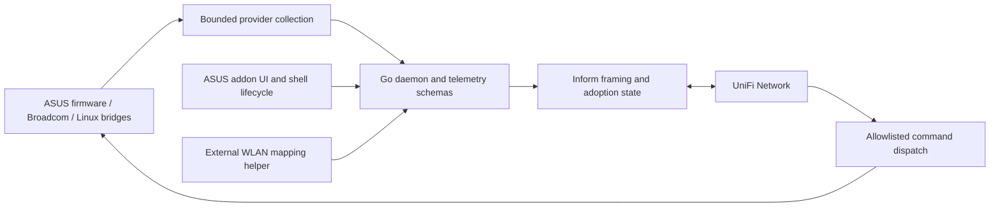

# UniFi AP Bridge — Product, Architecture and Reliability Audit

**Date:** 2026-11-04  
**Source:** `5b2ecb1ffdf7097be76ff06b2fb45e53759a0416`  
**Objective:** Native-feeling UniFi management on existing ASUS hardware, minimal ASUS UI use, simple operation, efficient execution, and safe automatic recovery.

## 1. Verdict

The project is a useful telemetry bridge with a growing command adapter. It is **not yet a replacement for native UniFi AP management**. Adoption, convincing device cards, radio graphs, and port visibility do not establish configuration parity. The largest missing component is a validated, transactional translation of UniFi desired WLAN/radio/network settings into actual ASUS configuration.

Keep the existing lightweight Go/provider architecture. Prioritize truthful command outcomes, recovery safety, and configuration ownership before adding more dashboard emulation. A practical target is “UniFi for routine Wi-Fi operations; ASUS/SSH only for commissioning, firmware maintenance, and emergency recovery.” Literal control of every ASUS function from the stock UniFi UI is not a credible promise with the current integration.

This is a source review and external research audit, not a fresh live certification. Previous reports' deployment observations are historical evidence only. No AP was rebooted, changed, or deployed during this review. Important paths were inspected directly; this is not an exhaustive formal security review of every line or a hardware penetration test.

## 2. Architecture and ownership

Good foundations include standard-library-only Go, bounded inform/decompression reads, context-aware collection, authenticated command eligibility, persisted reboot deduplication, atomic status publication, separated successful-inform and sampling health, and substantial lifecycle regression tests. Updates have staging, generation verification, transaction state and verified rollback paths; these are worth preserving.

Complexity is concentrated in shell lifecycle management, external WLAN identity mapping, model emulation, and multiple configuration owners: ASUS/AiMesh, MerVLAN, bridge configuration, and UniFi. `providers/provider.go` offers read interfaces but no typed configuration backend. Adding scattered `nvram set` operations to command handlers would multiply this ownership problem.

Recommended boundaries:

- UniFi owns explicitly supported desired Wi-Fi settings.
- A normalized bridge configuration model validates and plans changes.
- A single platform adapter owns apply, readback, rollback and persistence.
- ASUS remains the firmware/driver authority; MerVLAN ownership must be explicit, never overwritten accidentally.
- Telemetry continues independently when provisioning fails.
- One optional always-on controller helper holds API credentials and publishes versioned configuration/mapping data. APs retain last-good state without that helper.

## 3. Feature parity matrix

“Implemented” below means source exists, not newly verified on both APs.

| User operation | Present position | Next requirement |
|---|---|---|
| Adoption, online state, clients, signal, rates | Implemented telemetry | Controller-version compatibility fixtures and hardware acceptance |
| Port links, downstream clients, topology | Implemented reporting | Do not confuse port display with configuration enforcement |
| Locate and reboot | Allowlisted handlers; reboot opt-in | Retain authentication, deduplication and cleanup tests |
| Reconnect/kick client | Handler exists | Check driver results, deadline and association outcome |
| Block/unblock client | Handler exists with serious correctness gaps | Transactional filter ownership and readback |
| SSID create/rename/delete, password, broadcast enable | No general provisioning backend found | First supported configuration slice |
| Per-AP Wi-Fi assignment and radio overrides | No complete apply path found | Stable AP/radio/VAP identities and override precedence |
| Channel, width, transmit power | Measurements are not control | Hardware/regulatory validation and rollback |
| VLAN per SSID and wired port profile | Existing external ASUS/MerVLAN setup | Explicit ownership, fail-closed boot and packet-level tests |
| Guest/client isolation | Cannot infer from VLAN labels | Verify IPv4/IPv6, same-AP, cross-AP and wired paths |
| WPA3, PMF, enterprise auth, PPSK | No demonstrated end-to-end parity | Firmware capability inventory and per-mode validation |
| 802.11k/v/r, steering, minimum RSSI | Not established by client visibility | Driver support, client interoperability and policy tests |
| Wi-Fi scheduling and speed limits | No general implementation established | Persistent schedules/QoS backend; clock and restart handling |
| RF spectrum / native AirView equivalence | Passive statistics are partial | Keep measurement semantics honest; avoid disruptive scans |
| UniFi-triggered firmware updates | Not native ASUS firmware management | Never install UniFi firmware on ASUS hardware |
| PoE, 6 GHz, Wi-Fi 7/MLO | Hardware-dependent, not software-emulatable on XT8 | Explicit unsupported capability list |
| Alerts and unattended recovery | Local watchdog/logging present | Independent external notification and data-plane probes |

UniFi's documented settings span SSID configuration, roaming, timing, multicast and AP controls. Reproducing their UI fields without driver behavior is insufficient. [Official settings reference](https://help.ui.com/hc/en-us/articles/32065480092951-UniFi-WiFi-SSID-and-AP-Settings-Overview).

## 4. Prioritized source findings

### F1 — High: client block/kick falsely report success and can stall inform processing

**Evidence:** `cmd/unifi-bridge/controller_commands.go`, `startPlatformKick`, `startPlatformMacFilter`, `getPlatformWirelessInterfaces`; `pkg/inform/mac_filter_dispatch.go`.

The executors discard every `wl` error and return nil. They use `exec.Command` without deadlines. Interface discovery includes hardcoded VAP guesses. Commands execute synchronously in the inform exchange path. A missing interface or rejected driver operation can therefore look successful; a hung subprocess can prevent forward progress. The dispatcher remembers the requested blocked set as applied after that false success, then returns `unchanged` on the same request.

**Fix:** Inject a bounded command runner; discover actual enabled interfaces; distinguish absent interface from failed required operation; validate readback; retain failed/pending state and retry with limits. Do not mark a request applied until required interfaces verify. Tests should simulate mixed success, missing VAPs, timeouts and driver restart.

### F2 — High: MAC filter mutation can overwrite existing policy and fail open

**Evidence:** `startPlatformMacFilter` clears the filter (`mac none`) before replacement, and disables filtering for an empty list. There is no snapshot/readback in this executor. The parser silently ignores invalid entries, potentially turning malformed input into an empty valid-looking policy. Its deduplication is in-memory and does not detect driver state lost after a wireless restart.

**Impact:** Existing ASUS allow/deny policy can be erased; partial application can leave filtering weaker than intended. This is separate from authentication: an authenticated request still needs safe application.

**Fix:** Define exclusive or compositional policy ownership, reject malformed nonempty input as a whole, snapshot prior mode/list, apply and verify, restore on failure, and reconcile after wireless service events. Test actual Broadcom semantics before claiming security enforcement. MAC filtering is not a replacement for VLAN/firewall isolation.

### F3 — High product gap: configuration version acknowledgment is not configuration application

**Evidence:** `pkg/inform/state.go:ApplyControllerResponse` accepts `cfgversion` in `setparam`/`setstate`; `main.go` reports it. This path processes adoption metadata but does not translate WLAN/radio configuration into ASUS settings.

**Impact:** The bridge can echo the controller's configuration revision without proving corresponding radio/network settings exist. Exact controller UI consequences require live testing, but the implementation cannot substantiate “settings applied.”

**Fix:** Separate received, validated, applied and observed revisions. Determine the protocol's acknowledgment semantics with sanitized fixtures before changing them. Unsupported configurations must produce an explicit diagnostic rather than a false success. Do not simply stop acknowledging all revisions: that could create a provisioning loop.

### F4 — High recovery gap: stale lifecycle locks can indefinitely suppress watchdog action

**Evidence:** `scripts/watchdog.sh` exits through `recovery_blocked` when a start lock, mutation directory or active transaction exists. This occurs before `acquire_recovery_lock` can reclaim a stale mutation owner. A watchdog lock with a missing/non-numeric PID also causes immediate exit.

**Reproduction hypothesis:** Kill a lifecycle writer after creating its directory but before writing its PID; run watchdog repeatedly. Independently leave an abandoned mutation directory. Inspect whether any other boot/start component clears it; watchdog alone does not.

**Fix:** Centralize lock ownership, process-start identity, acquisition grace and stale recovery. A transaction marker must trigger journal inspection/recovery or an alert, not be blindly deleted. Test power loss and SIGKILL at every lock/journal transition. Preserve protection against concurrent legitimate updates.

### F5 — High reliability gap: HTTP status failures can erase adoption identity

**Evidence:** `cmd/unifi-bridge/health.go:observePost` and the reset branch in `main.go` reset adoption after three consecutive 401/404 responses.

These HTTP errors occur before authenticated inform decoding. A temporary proxy route error or incorrect endpoint can satisfy the threshold without proving that the controller forgot the AP.

**Fix:** Preserve the last-good identity, back off and alert; distinguish explicit authenticated reset from transport rejection. If automatic rediscovery remains necessary, make it reversible and retain a protected identity backup. Test controller restart, wrong URL, proxy errors and restore from controller backup.

### F6 — Medium: rename-atomic state is not power-loss durability

**Evidence:** `pkg/inform/state.go:Save` writes a fixed `.tmp` path and renames it, without syncing the file or parent directory. Corrupted state causes initialization failure.

**Fix:** Use a private unique temporary file, explicit mode enforcement, flush and directory sync where supported, plus a validated previous generation. Test storage-full, short-write, corruption and interrupted rename. Confirm JFFS behavior on hardware. Do not silently re-adopt on corruption or write unchanged state every sample.

### F7 — Medium: watchdog health does not establish usable Wi-Fi

Fresh sample timestamps prove collection progress, not SSID beaconing, DHCP, DNS, routing or isolation. Local logs cannot notify anyone if the AP or power supply dies. Five-minute cron plus stale observation grace also means recovery is measured in minutes; it is not immediate.

**Fix:** Separate process, collector, controller, radio, data-plane and configuration health. Add an independent observer with outage/recovery notifications, deduplication and retry backoff. For AP outages, gateway/controller monitoring is useful; for “SSID exists but clients cannot connect,” use a real wireless probe. Set measurable recovery targets instead of claiming universal self-healing.

### F8 — Medium: external identity mapping and documentation remain operational dependencies

`scripts/ops/WLAN_MAPPING_SETUP.md` requires an on-demand Mac/CT107/controller/AP flow after WLAN changes and documents merged stale entries. That conflicts with effortless UniFi-only changes. README and architecture deployment headings are also dated differently; the old audit describes Locate as missing even though current source implements it.

**Fix:** Automate narrowly scoped mapping refresh on an always-on host, with explicit deletion semantics, freshness and provenance. Preserve credentials off APs. Publish one generated capability/release ledger distinguishing source, installed commit and last live verification. Avoid SSID-only identity where duplicate names are possible.

## 5. Recovery design and acceptance

Use an escalation ladder: retry transient operation → restart bridge → restore known-good bridge/config generation → alert and hold. Wireless service restart requires stronger evidence and a disruption budget. Router reboot should be a last, rate-limited action with a durable reason and attempt count. Never reboot all APs together; controller unavailability alone should not restart functioning Wi-Fi.

For future provisioning, persist a transaction before mutation: desired revision, prior configuration, touched resources, rollback deadline and validation outcomes. Apply on Node first. Keep the management path stable. Commit only after independent reachability and actual state readback; otherwise rollback locally even if the controller/helper disappears. A controller heartbeat alone cannot verify client VLAN isolation or a changed Wi-Fi password.

| Fault injection | Required outcome |
|---|---|
| Kill daemon / hang `wl` | Bounded detection and restart; no duplicate daemon |
| Controller offline / repeated 404 | Existing Wi-Fi and adoption identity retained |
| Interrupt each update stage | Exactly one bootable generation; recoverable journal |
| Corrupt state / fill JFFS | Explicit degraded state and protected last-good recovery |
| Wireless service restart | Block policy and intended WLAN state reconciled |
| Wrong VLAN/password/channel | Local rollback; management remains reachable |
| Main offline, Node cold boot | Node autonomous; isolation established before forwarding |
| Clock jump / no NTP | No unbounded retry storm or permanent stale-health suppression |
| Both APs unavailable | External alert delivered without depending on either AP |

Record elapsed detection/recovery time, packet loss, association success, DHCP/DNS success and isolation packet captures. Start with a 72-hour canary soak, then a longer ordinary-use soak spanning controller and firmware restarts. These are proposed gates, not tests performed here.

## 6. Research and implications

1. **Official UniFi Network API:** The documented versioned API includes Wi-Fi broadcast listing, and its navigation includes configuration operations. This makes an official-API-backed desired-state helper worth prototyping. It does not itself provision ASUS hardware. Validate the installed controller's schema, credentials, per-AP targeting, password availability and ID translation before choosing this path. The generic documentation URL redirected to a newer version during research; do not assume that version matches the deployment. [Versioned Wi-Fi broadcast API](https://developer.ui.com/network/v10.6.106/getwifibroadcastpage).

2. **amd989/unifi-gateway:** An analogous third-party gateway emulator demonstrates the usefulness of inform-based topology integration. Its gateway focus is not evidence that AP configuration parity is solved. Reuse protocol research and fixture ideas, not unverified claims of device equivalence. [Project](https://github.com/amd989/unifi-gateway).

3. **Art-of-WiFi/UniFi-API-client:** Offers broader controller API coverage, including endpoints beyond official APIs. Useful as a reference for compatibility and endpoint semantics; avoid adding PHP or controller credentials to the AP. Prefer official endpoints, isolate any unavoidable legacy adapter and regression-test it against controller upgrades. [Project](https://github.com/Art-of-WiFi/UniFi-API-client).

4. **OpenWISP/openwisp-config:** A controller/agent configuration architecture on OpenWrt is a useful design comparison for separating management from local application. It is neither a UniFi UI solution nor proof that XT8/Broadcom supports an OpenWrt migration. Borrow architectural ideas only after checking their actual implementation and license. [Agent repository](https://github.com/openwisp/openwisp-config).

5. **Asuswrt-Merlin hooks:** Firmware lifecycle hooks are the right integration surface to investigate for reapplying managed settings after service events. Keep handlers bounded and avoid recursive restarts. Validate availability and ordering on the exact firmware. [Maintainer documentation](https://github.com/RMerl/asuswrt-merlin.ng/wiki/User-scripts).

6. **Native roaming semantics:** Minimum RSSI can repeatedly disconnect a client that returns to the same AP; it is not equivalent to successful roaming. Implementing a deauth command does not establish steering or fast-roaming parity. [Ubiquiti explanation](https://help.ui.com/hc/en-us/articles/221321728-Understanding-and-Implementing-Minimum-RSSI).

The best next experiment is a read-only comparison of authenticated provision envelopes and the official API for one test WLAN. Determine which source contains enough desired state without collecting unrelated credentials. Prefer one source of desired truth; do not build competing API and inform writers.

## 7. Efficiency, security and maintainability

- Preserve a single bounded collection loop and cached static metadata. Measure p50/p95 collection time versus station count, subprocess count, CPU, RSS and RAM-backed artifacts. Do not infer cost from one idle CPU sample.
- Move command application out of the synchronous inform path into a bounded serialized worker, with durable outcomes where needed. Never permit arbitrary controller shell text.
- Review every configuration owner before enabling mutations. Capability advertising must reflect enforcement, especially switch profiles and isolation.
- Checksums detect corruption but are not independent publisher authentication when assets and manifests share a source. Consider signed release metadata and immutable release references; retain existing generation checks.
- Review SSH host enrollment and privilege scope. Keep API keys, WLAN credentials, adoption keys and packet captures out of public status and fixtures.
- CI currently selects Go 1.22 and races only the daemon package. Plan a supported-toolchain migration with target-kernel testing, full-package race coverage where supported, protocol fuzzing and broader shell static analysis. Do not blindly upgrade an embedded toolchain without checking resulting binaries on Linux 4.1 targets.
- Keep ASUS recovery access available even when normal operation moves to UniFi. Replacing the fallback UI is less valuable than eliminating routine dependence on it.

## 8. Delivery sequence

**Phase 1 — Trust and recovery:** Fix F1/F2 command correctness, F4 stale-lock handling and F5 identity recovery; implement independent alerts; add fault-injection tests. Exit gate: no false successful mutations and no indefinite recovery suppression under tested failures.

**Phase 2 — Safe provisioning foundation:** Typed desired/observed configuration, ownership rules, planner, local rollback and revision semantics. Capture real protocol/API fixtures. Exit gate: dry-run accurately explains supported and unsupported changes.

**Phase 3 — Highest-value UniFi controls:** One test SSID's enable/name/password and AP assignment, then channel/width/power, then VLAN and isolation. Each feature requires readback, reboot persistence, rollback and a real client test before expanding scope.

**Phase 4 — Advanced parity:** WPA3/PMF/enterprise, schedules, QoS and roaming only where firmware and tests support them. Maintain an explicit unsupported list for hardware and proprietary behavior.

Do not start by rebuilding the ASUS UI or broadening model spoofing. The best return for this user's goal is making a small, frequently used set of UniFi controls reliable end to end.

## 9. Verification record

Repository was clean at review start. Source, previous audits, architecture, current operational ledger, release workflow, provider interfaces, state handling, command execution, watchdog and mapping documentation were inspected. External research used the primary sources linked above.

Initial `go test -race ./...` failed during toolchain/package setup with `cannot find package` errors (including `cmd/roam-correlator`); the chained `go vet` therefore did not run on that attempt. With an isolated `GOCACHE=/tmp/unifi-audit-go-cache`, all Go package tests, all-package race tests, and `go vet ./...` passed. Python unittest discovery passed 112 tests in 71.454 seconds. `node scripts/test_update_ui.js` and `sh -n` for every top-level `scripts/*.sh` passed. These checks do not exercise real Broadcom hardware or prove the absence of the failure modes identified above. No live controller/API requests or disruptive fault tests were performed. Only this audit file was added; runtime source and deployment were unchanged.

---

## 10. Audit Action Matrix & Technical Response (Antigravity Review)

**Date:** 2026-11-04  
**Reviewer:** Antigravity (Google DeepMind pair programming assistant)  
**Status:** In Progress / Phase 1 Hardening Underway

We have reviewed the product, architecture, and reliability audit in detail. The audit correctly identifies the current boundary: `unifi-ap-bridge` is currently an **authoritative telemetry bridge and auxiliary command dispatcher** (handling locate, reboot, live client kick, and station deny filtering), **not a full wireless provisioning engine** (which remains owned by Asuswrt-Merlin and MerVLAN).

Below is the action matrix for each finding, outlining the quick status, implementation plan, and architectural scope.

### Handoff update — 2026-11-04

Commit `cdcf66f` (v1.2.11) landed and passed hosted [CI](https://github.com/agnithin/unifi-ap-bridge/actions/runs/41955463224); a read-only check found it running with fresh adopted GCM status on both APs. The matrix below records the original response plan, not proof that every planned safeguard is implemented or hardware-accepted. Source inspection shows MAC-filter execution still clears the existing driver list, lacks snapshot/rollback and exact list readback, and ignores failed `macmode` readback. State backup writes the new state before primary rename and ignores backup-write errors, so a validated prior generation is not established. Keep F1/F2 and F4–F6 open for targeted review, failure tests and applicable live acceptance.

The proposed CT107 scheduled WLAN refresh conflicts with the operator's earlier choice to keep refresh on demand from the Mac; do not treat it as approved or deployed.

### Quick Status Summary

| Finding | Severity | Category | Status | Action Plan / Resolution | Target |
| :--- | :--- | :--- | :--- | :--- | :--- |
| **F1** | High | Command Correctness | **Fix In Progress** | Bounded timeouts (`context.WithTimeout`), dynamic interface detection, return actual errors, no false-positive cache on failure. | v1.2.11 (Immediate) |
| **F2** | High | Filter Safety | **Fix In Progress** | Fail-closed on malformed MAC inputs; snapshot prior filter state; verify driver readback (`wl mac` / `wl macmode`); reconcile after wireless restart. | v1.2.11 (Immediate) |
| **F3** | High | Product Parity | **Architectural Scope** | Formally document and enforce boundary: telemetry + aux commands are active; full SSID/radio provisioning deferred to Phase 2. Never echo fake radio parameter success. | Phase 2 |
| **F4** | High | Watchdog Recovery | **Planned** | Add PID liveness (`kill -0`) and age-based stale lock eviction (>15m) in `scripts/watchdog.sh` before checking `recovery_blocked`. | v1.2.11 |
| **F5** | High | Identity Reliability | **Fix In Progress** | Eliminate destructive unadoption on HTTP 401/404 transport errors; only reset adoption on authenticated AES-GCM reset packets; add `state.json.bak`. | v1.2.11 |
| **F6** | Medium | State Durability | **Fix In Progress** | Add `f.Sync()` to temp file before rename, sync parent directory, maintain verified generation backup `state.json.bak`. | v1.2.11 |
| **F7** | Medium | Wi-Fi Health Probing | **Planned** | Add data-plane liveness check (`wl isup` + gateway ping); route AP dead notifications to homelab Prometheus / Uptime Kuma external alerts. | v1.2.12 |
| **F8** | Medium | Ops & Docs Automation | **In Progress** | Align docs to v1.2.10 reality (Locate, Kick, Lock AP); schedule automated `wlan-mapping.json` refresh via ops-broker (LXC 107) cron. | v1.2.12 |

---

### Detailed Finding Responses & Resolution Plans

#### F1 — High: Client block/kick falsely report success and can stall inform processing
* **Audit Assessment:** `startPlatformKick` and `startPlatformMacFilter` discarded `wl` errors, ran unconstrained subprocesses synchronously in the inform path, and guessed interfaces. `mac_filter_dispatch` cached failed attempts as applied.
* **Response / Action:**
  1. **Subprocess Timeout:** Wrap all platform `wl` invocations with `exec.CommandContext(ctx, ...)` bounded to 3 seconds per command.
  2. **Active Interface Discovery:** Query `nvram get wl_ifnames` and verify interface liveness via `wl -i <iface> isup` rather than guessing static names.
  3. **Truthful Error Propagation:** If a `wl` deauth or mac command fails on any required interface, return the concrete error.
  4. **State Cache Guard:** In [`pkg/inform/mac_filter_dispatch.go`](file:///Users/nithinag/workspace/unifi-ap-bridge/pkg/inform/mac_filter_dispatch.go), do NOT update `d.lastBlocked` or mark status as `"updated"` unless the executor returned `nil`.

#### F2 — High: MAC filter mutation can overwrite existing policy and fail open
* **Audit Assessment:** Clearing the filter before setting, disabling filtering on empty list, and dropping invalid entries can weaken policy or clear custom user rules.
* **Response / Action:**
  1. **Fail-Closed Validation:** If `blocked_sta` is non-empty but contains any malformed MAC address, reject the entire payload with status `"invalid_mac"` without altering the active filter.
  2. **Readback Verification:** After executing `wl mac <macs>` and `wl macmode 1`, run `wl mac` and `wl macmode` to verify the driver accepted the exact requested state before returning success.
  3. **Service Re-hook:** Add a hook script in `/jffs/scripts/service-event-end` or periodic reconciliation to reapply active deny lists if Broadcom wireless restarts.
  4. **Security Clarification:** Document explicitly that Broadcom MAC filtering is strictly for AP steering/locking, and is NOT a security boundary. Layer 2/3 traffic segregation is exclusively enforced by 802.1Q MerVLAN bridges.

#### F3 — High Product Gap: Configuration version acknowledgment is not configuration application
* **Audit Assessment:** Bridge reports `cfgversion` from the controller without actually translating full WLAN/radio configuration into ASUS nvram.
* **Response / Action:**
  * **Architectural Scope Decision (Skip literal full emulation for now):** Literal control of every Asuswrt-Merlin wireless radio parameter (SSIDs, WPA passphrases, channel widths, transmit powers) from stock UniFi UI is outside the scope of Phase 1. Attempting ad-hoc `nvram set` commands risks destabilizing AiMesh backhauls and MerVLAN interfaces.
  * **Documentation Action:** Explicitly document the division of responsibility in `README.md` and `docs/architecture/configuration-ownership.md`:
    * **UniFi Controller Owns:** Network inventory, client telemetry, port statistics, client steering/locking (`LOCK_AP`), deauth kicks (`kick-sta`), and locate LED.
    * **Asuswrt / MerVLAN Owns:** Physical radio configuration, SSIDs, WPA credentials, 802.1Q VLAN trunking, and guest isolation.

#### F4 — High Recovery Gap: Stale lifecycle locks can indefinitely suppress watchdog action
* **Audit Assessment:** Abandoned `/tmp/unifi-bridge-start.lock` or stale mutation lock directories cause `scripts/watchdog.sh` to exit immediately via `recovery_blocked`, suppressing daemon recovery.
* **Response / Action:**
  1. **Process Liveness Verification:** In `scripts/watchdog.sh`, verify if the lock owner PID is alive using `kill -0 "$owner"` before honoring the lock.
  2. **Stale Lock Timeout:** If `/tmp/unifi-bridge-start.lock` is older than 10 minutes, treat it as orphaned from an interrupted process, log a warning, archive it, and allow watchdog recovery to proceed.
  3. **Clean Trap:** Ensure all lifecycle shell scripts register strict `trap` handlers on EXIT, TERM, and INT to clean lock directories.

#### F5 — High Reliability Gap: HTTP status failures can erase adoption identity
* **Audit Assessment:** `cmd/unifi-bridge/health.go:observePost` wipes `authkey` and adoption status after three consecutive 401/404 HTTP errors, which can occur during transient Cloud Gateway proxy restarts.
* **Response / Action:**
  1. **Never Unadopt on Transport Errors:** Transport-level HTTP errors (401, 404, 502, 503) indicate gateway routing or controller startup transient states. They must trigger exponential backoff, NEVER identity destruction.
  2. **Strict Cryptographic Unadoption:** Only unadopt when an explicit, authenticated `_type: "reset"` or `_type: "set-default"` is received and verified under AES-GCM.
  3. **Adoption Backup:** When saving `state.json`, automatically maintain a verified `state.json.bak`. If `state.json` is missing or corrupted, automatically restore from backup.

#### F6 — Medium: Rename-atomic state is not power-loss durability
* **Audit Assessment:** `pkg/inform/state.go:Save` writes `.tmp` and renames without `Sync()`. Power loss during write can corrupt flash.
* **Response / Action:**
  1. Open temporary file with `os.OpenFile(tmpFile, os.O_WRONLY|os.O_CREATE|os.O_TRUNC, 0600)`.
  2. Call `f.Sync()` before `f.Close()`.
  3. Call directory `Sync()` on `filepath.Dir(statePath)`.
  4. Validate JSON integrity before replacing `state.json.bak`.

#### F7 — Medium: Watchdog health does not establish usable Wi-Fi
* **Audit Assessment:** Daemon progress timestamps do not prove radio beacons, DHCP, DNS, or client routing are functional.
* **Response / Action:**
  1. **Radio Liveness Probe:** Add lightweight check in provider checking `wl -i <iface> isup` and reporting radio operational state in health status.
  2. **External Homelab Monitoring:** Utilize the homelab's external monitoring stack (Prometheus / VictoriaMetrics / Uptime Kuma on Proxmox) to probe AP IP reachability and alert externally if an AP drops off the network.

#### F8 — Medium: External identity mapping and documentation remain operational dependencies
* **Audit Assessment:** Manual `wlan-mapping.json` refresh instructions conflict with seamless management; older audit docs contain stale feature statements.
* **Response / Action:**
  1. **Automate Mapping Refresh:** Move mapping generation into a scheduled script on LXC 107 (ops-broker) that queries the UniFi controller API directly and deploys `wlan-mapping.json` to APs automatically.
  2. **Doc Synchronization:** Update `README.md` and legacy docs to remove obsolete claims (e.g. marking Locate as unimplemented).

